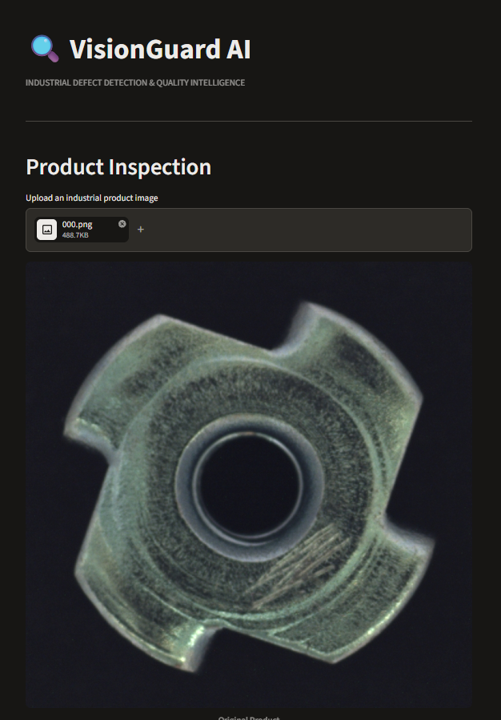
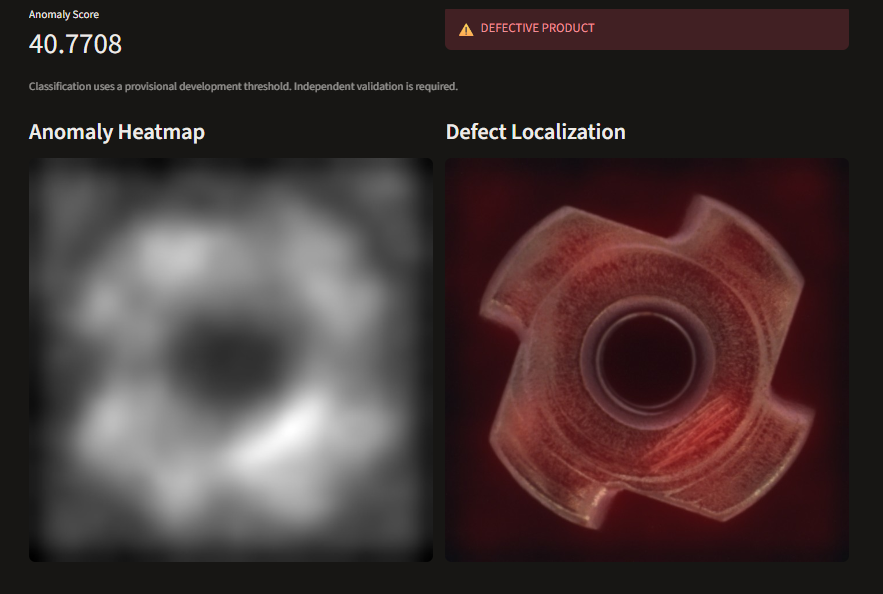
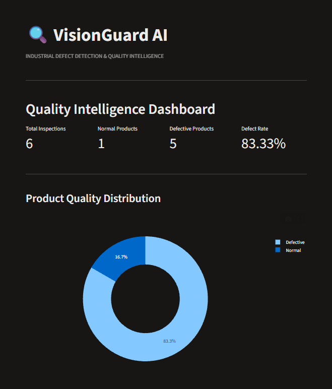
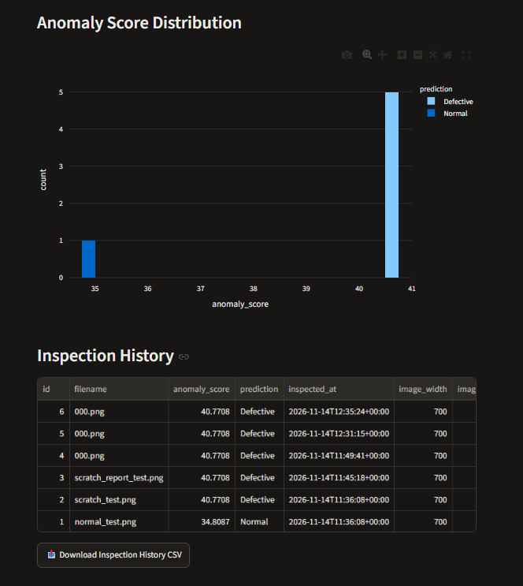
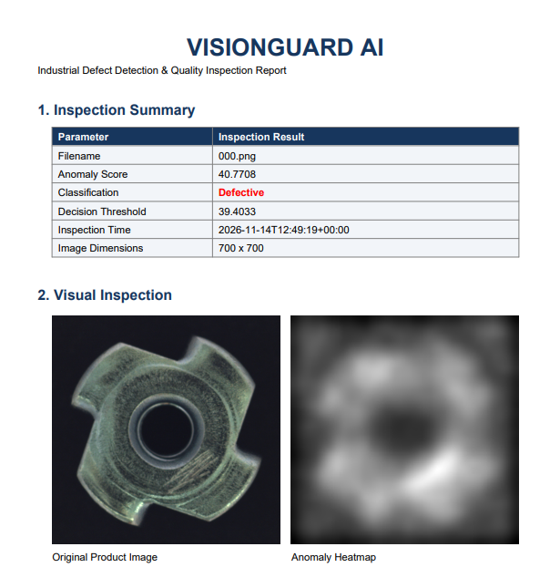
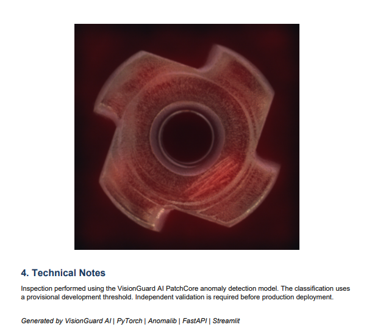

# VisionGuard AI
### AI-Powered Industrial Defect Detection and Predictive Quality Intelligence

VisionGuard AI is a computer vision prototype that detects anomalous industrial products using PatchCore, visualizes suspicious regions through anomaly heatmaps, maintains inspection history, and generates PDF inspection reports.

## Key Features

- PatchCore-based industrial anomaly detection
- Anomaly heatmaps and defect localization overlays
- FastAPI prediction backend
- Streamlit inspection dashboard
- SQLite-based inspection history
- Quality analytics and CSV export
- PDF inspection report generation

## Technology Stack

| Area | Technologies |
|---|---|
| Deep Learning | PyTorch, Torchvision, Anomalib |
| Model | PatchCore, Wide ResNet-50-2 |
| Backend | FastAPI, Uvicorn |
| Frontend | Streamlit, Plotly |
| Image Processing | Pillow, NumPy |
| Database | SQLite |
| Reporting | ReportLab |

## System Architecture

```text
                 User uploads image
                         |
                         v
               Streamlit Dashboard
                         |
                         v
                  FastAPI Backend
                         |
                         v
                  PatchCore Model
                         |
               Anomaly Score + Map
                         |
              +----------+----------+
              |          |          |
              v          v          v
          Prediction   SQLite    Heatmap
                       History   Visualization
              |
              v
         PDF Report
         


---

## Application Screenshots

### 1. Product Inspection


### 2. AI Defect Detection Results


### 3. Quality Analytics Dashboard


### 4. Inspection History and Anomaly Distribution


### 5. PDF Inspection Report



